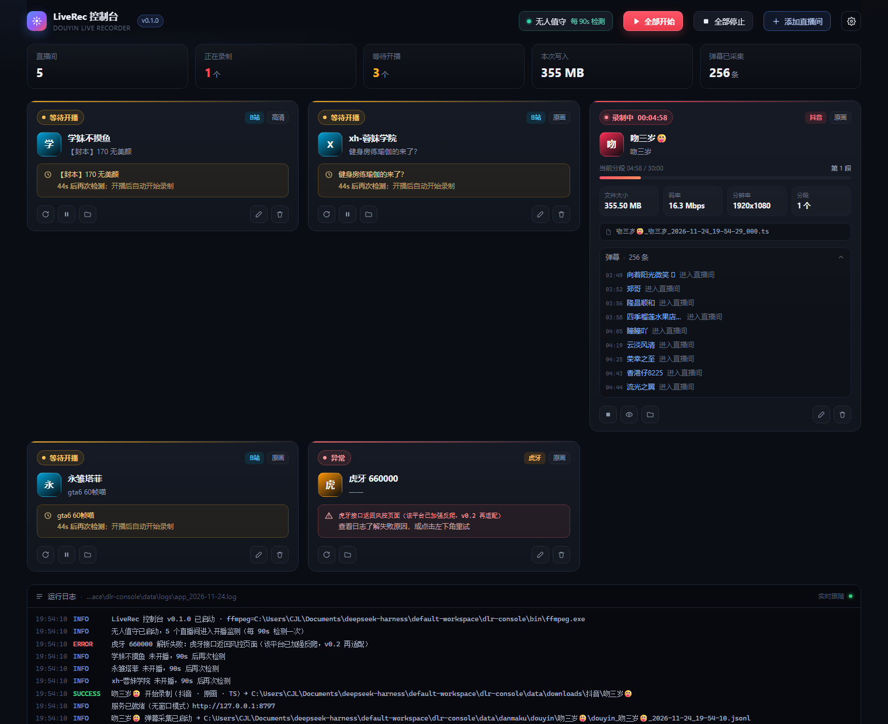
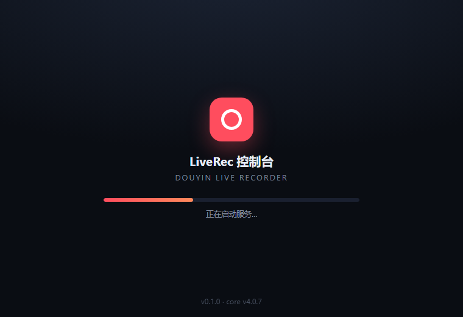
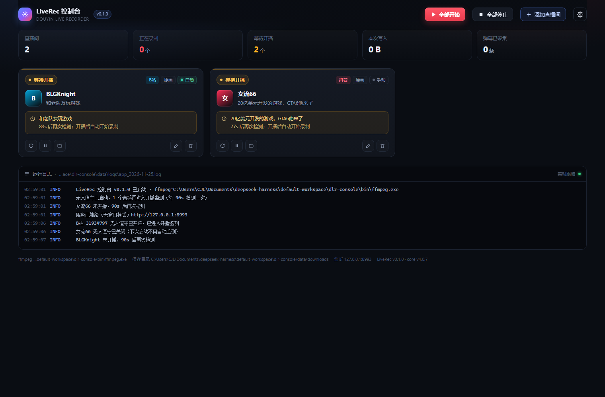
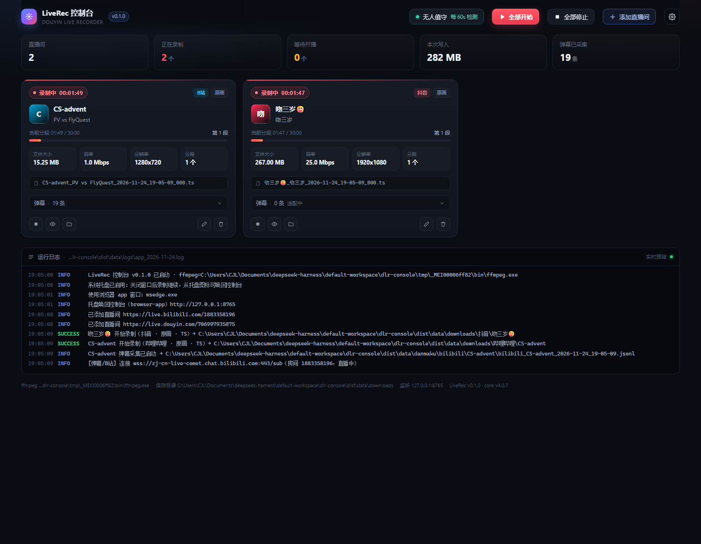

# LiveRec 控制台


## 功能

- **多房间并发录制**：每个直播间一张卡片，同时录制互不阻塞；房间状态机 `空闲 → 等待开播 → 录制中 → 已停止 / 异常`
- **无人值守（每张卡片独立）**：卡片右上角有个「自动 / 手动」小标签——绿色「自动」= 下次启动程序时会自动进入开播监测，「手动」= 启动后保持待机、等你点开始。状态跟着房间一起存进 `data/ui_state.json`，关程序时自动记录，下次启动按各自的状态恢复。检测间隔在「设置」里改（默认 60 秒）；主播下播后自动回到等待，等下一场
- **卡片实时信息**：状态与已录时长、主播名与标题、当前分段进度、文件大小 / 码率 / 分辨率、正在写入的文件名、弹幕条数与最近弹幕
- **每张卡片两个开关**：绿色「自动」= 下次启动会自动进入开播监测（默认**关闭**，新装的程序不会偷偷开录）；蓝色「弹幕」= 这场要不要录弹幕（关掉就是只录视频；切换时会重启该房间的录制任务）
- **单线路**：每个直播间只跑一条解析出来的线路，不再在十几条死线路之间来回切。这条线路一个字节都没出（下播 / 风控 / 地址失效）就直接回「等待开播」，按检测间隔再试，不会把卡片卡在「录制中」
- **弹幕路径可配置**：默认写到每场录像目录下的 `danmaku/`（跟视频放一起），也可以在「设置 → 弹幕保存路径」里钉一个固定目录
- **启动自检**：程序一打开就把抖音 / B站 / 虎牙 / 斗鱼四份 Cookie 各查一遍，结论写进运行日志（每平台一条：登录有效 / 登录态字段 / 已失效 / 未设置）
- **后台录制**：ffmpeg 以 CREATE_NO_WINDOW 方式拉起，录制全程不弹控制台黑窗、不抢焦点，进度通过 -progress pipe:2 回读
- **一键操作**：全部开始 / 全部停止，单卡开始、停止、立即重试、打开录制目录、打开直播页、编辑、删除（6 秒内点两次确认，录制中的卡片也能删——确认态存在页面状态里，卡片每秒刷新不会把它冲掉）；**停止后随时可以再点开始继续录**（快连点也不会卡死，每次开始都会从 0 重新计时、分段与弹幕会话重新开一份）；删除卡片会先把该房间的 ffmpeg 与弹幕连接停干净，不会留下后台进程
- **添加直播间**：粘贴分享链接即可，自动识别平台与主播名，画质下拉会按该直播间**真实可选的档位**给出（抖音/B站/斗鱼各取各的接口；虎牙录制已下线），再选保存格式 / 代理 / 分段 / 是否采集弹幕

抖音支持这几种链接（都取最后那串数字当房间号，`?anchor_id=…` 之类的参数会被忽略）：

```
https://live.douyin.com/531854687617
https://live.douyin.com/share/531854687617
https://www.douyin.com/follow/live/531854687617?anchor_id=61608272917
https://www.douyin.com/root/live/531854687617
https://v.douyin.com/xxxxxx/            # 短链，会先跟一次跳转再取
```

`www.douyin.com/user/<sec_uid>` 这种是**个人主页**、不含房间号，会提示改用直播间地址。
- **弹幕采集**：与录像同一时间轴（`offset_ms` 相对本次录制起点），落 JSONL + SQLite 索引，后续做词云、切片、精彩片段都直接读这两份数据；每次开始录制都是独立会话（session_id 带随机后缀），所以「停止→再开始」后卡片上的条数只会从 0 重新长，不会把上一场的数字串进来
- **实时日志**：状态变更、解析失败原因、ffmpeg 中断原因都在页面底部滚动，同时写入 `data/logs/app_YYYY-MM-DD.log`
- **系统托盘常驻**：关掉窗口录制照常继续，托盘图标可以唤回控制台、全部开始 / 全部停止、打开录制目录、切换无人值守、彻底退出；鼠标悬停能看到「录制中 N 路 · 等待 N 路」
- **启动画面**：双击后先出一个带进度条的深色启动窗口（正在启动服务 → 加载配置 → 即将打开控制台），服务就绪后自动切换到控制台，不会先闪一个空白页
- **窗口图标统一**：控制台窗口的标题栏、任务栏、托盘都用 exe 自带的那枚图标（红底圆点）
- **单实例**：托盘常驻时重复双击 exe 不会再起第二个录制进程，只会把已开的窗口唤到前台
- **与上游配置互通**：直接读写 `config/config.ini` 与 `config/URL_config.ini`，命令行跑上游脚本与用界面互不冲突



## 平台支持

| 平台 | 录制 | 弹幕 | 说明 |
| --- | --- | --- | --- |
| 抖音 | ✅ | ✅ | 录制走 `a_bogus` 签名接口取原画 flv；弹幕走 WSS 推送 + webmssdk 签名 + protobuf 解包 |
| B站 | ✅ | ✅ | 弹幕走 `buvid3` + wbi 签名的 `getDanmuInfo` 取节点再 WSS 订阅（聊天/礼物/上舰/进场全收）；录制按 `qn` 分档取流，未登录最高「超清」，想拿「原画」需在设置里填登录 Cookie |
| 虎牙 | ❌ 已下线 | — | **暂停支持**：虎牙的流地址（wsSecret）一次性失效、各 CDN 频繁掐断，录不稳，先把录制支持整体关掉。实现仍保留在 `liverec/huya.py`（对外 `resolve / qualities / next_stream / drop_cache / resign / fresh_line / target_bitrate`），恢复时清空 `liverec/resolver.py` 里的 `DISABLED_PLATFORMS` 即可。添加虎牙链接现在会直接报「虎牙录制已暂时下线」，已有的虎牙房间启动时会被置为待机、不再自动重试 |
| 斗鱼 | ✅ | ✅ | 改走官方 `playweb.douyucdn.cn/lapi/live/hlsH5Preview`（`md5(rid+time)` 签名），实测 1440p 稳定连续录制，已不再依赖 Node/execjs；弹幕走弹幕服务器的**裸 TCP STT 协议**（8601/8602，不再走被墙掉的 WSS），聊天/礼物/进场都能收到 |

### 虎牙/斗鱼的取流实现（v0.1.1）

两个平台原来的接口都被风控后，现在的做法是：

- **虎牙**：`https://mp.huya.com/cache.php?m=Live&do=profileRoom&roomid=<数字房间号>`（移动端 UA），一次请求拿到 `liveStatus`、`profileInfo.nick`、`liveData.roomName` 和 `stream`（`baseSteamInfoList` 的 flv 线路 + `hls.multiLine` 的 m3u8 线路）。录制端把 11 条线路按「HLS 优先」逐条试，20 秒仍无数据就自动换下一条；房间号必须是数字（短名链接会提示）。
- **斗鱼**：`POST https://playweb.douyucdn.cn/lapi/live/hlsH5Preview/<rid>`，headers 带 `rid` / `time`（13 位毫秒）/ `auth=md5(rid+time)`，body 带 `did`，返回 `rtmp_url + rtmp_live`（m3u8），把 `.m3u8` 换成 `.flv` 即可 `-c copy` 直录；`error=104` 表示未开播。

### HLS 中转：修「某些 B站房间录不到」

B站有一部分房间（例如短号 `live.bilibili.com/<短号>` 会跳到真实房间 `80397` 这类）只下发 **HLS-fMP4**，播放列表里的分片是**相对 URI**：

```
#EXT-X-MAP:URI="h1795540126.m4s"
628318389.m4s
```

ffmpeg 解析相对 URI 时会丢掉 playlist 上的签名 query（`expires/sign/...`），分片请求被 CDN 403，表现为「开始录制 → 20 秒无数据 → 换线 → 报 `End of file`」。

修法：录制时给所有 `.m3u8` 输入起一个**本机中转**（`liverec/hlsproxy.py`，`ThreadingHTTPServer` 绑在 `127.0.0.1` 随机端口）：

- `/live.m3u8` 每次都去上游取最新播放列表，把所有 URI（含 `EXT-X-MAP` / `EXT-X-KEY` / 分片）改写成「本地地址 → 绝对地址 + 原 query」；
- `/seg/<key>.<ext>` 透传上游分片字节（保留原扩展名，ffmpeg 的扩展名白名单才放行，同时加 `-allowed_extensions ALL`）；
- 对 HLS 输入不再加 `-reconnect*`（会让 http 协议把「列表读完」当成 EOF 反复重连），改用 `-http_persistent 0`。

实测同一房间：修复前 0 B，修复后 `9.4 MB / 1280x720 / 弹幕 135 条` 连续录制，主播下播后正常回到「等待开播」。

### 斗鱼弹幕：走裸 TCP，不走 WebSocket

斗鱼的弹幕服务器 `danmuproxy.douyu.com` 在 8501–8506 上 TLS 握手会被直接拒（`sslv3 alert handshake failure`），但 **8601/8602 的裸 TCP 上仍是老的 STT 协议**，实测可用：

1. 连 `danmakuproxy.douyu.com:8601`（失败再退 8602 → 8506 → 8504 → 8502）；
2. 发登录串 `type@=loginreq/roomid@=<rid>/ver@=20190610/aver@=218101901/`，再发 `type@=joingroup/rid@=<rid>/gid@=-9999/`；
3. 每 30 秒发一次 `type@=keeplive/tick@=<毫秒>/`，收到 `pingreq` 就回 `type@=mrkl/`；
4. 按 `类型@=值/` 切字段，`chatmsg`（弹幕，`txt`/`nn`/`uid`）、`dgb`（礼物）、`uenter`（进房）、`ssd`（超级弹幕）转成事件，其余忽略。

> 「进入直播间」这类流水量很大（样本房 40 秒 256 条里 201 条是进房），实时抽屉里默认不展示，但 JSONL / SQLite 里是全量保留的，方便后续做数据分析。

### 可选画质：按链接识别该房间的真实档位

「添加/编辑直播间」里粘贴链接后，界面会同时调 `/api/preview` 与 `/api/qualities`，把画质下拉换成**这个直播间实际提供的档位**，并附一行来源说明：

| 平台 | 数据来源 | 特点 |
| --- | --- | --- |
| 抖音 | `webcast/room/web/enter` 的 `stream_url` | 按 flv 轨道分档：原画（origin）/ 蓝光 / 超清 / 高清 / 流畅 |
| B站 | `getRoomPlayInfo` 的 `g_playurl.g_qn_desc` + `accept_qn` | 列出 `current_qn` 以内的**全部档位**：未登录是「超清 / 高清 / 流畅」（不会再让你选必然被降级的「原画」），填了登录 Cookie 后才会出现「原画 / 蓝光」；档位越高越吃带宽 |
| 虎牙 | 已下线（保留代码） | 页面里的 `vBitRateInfo` + `mp.huya.com` 的 `stream.hls.rateArray` 合并 | 暂停支持期间不再提供给用户选择；恢复时按「每个码率各占一档」处理（高档位 `iBitRate` 常是 0，只能从档位名读码率） |
| 斗鱼 | `getH5PlayV1` 的 `rate`（0 原画 / 3 蓝光 / 2 超清 / 1 流畅） | 固定四档，选哪档就按哪个 `rate` 取流：实测同一房间 rate0/3/1 各录 6 秒分别是 2.4MB / 1.0MB / 0.7MB，码率真的会变（`betard` 的 `multirates` 很多房间只有一条，不能当档位表用） |

识别失败或房间未开播时会退回固定的六档（原画/蓝光/超清/高清/标清/流畅），并提示原因。

**关于斗鱼画质（重要）**：斗鱼真正能切档位的接口是 `getH5PlayV1` 的 `rate` 参数（`0` 原画 / `3` 蓝光 / `2` 超清 / `1` 流畅），签名链是 `wgapi/livenc/liveweb/websec/getEncryption` 给的 `rand_str/key/enc_time/enc_data/is_special` （`auth` 由 `rand_str` 反复 `md5(auth+key)` 得到，`did` 必须用匿名 guest id）。选不同档位会换到不同码率的流（实测 6 秒 2.4MB / 1.0MB / 0.7MB），卡片的档位说明也会写清楚。另外 `betard` 的 `multirates` 只代表房间自己标注的那条流，不能当作可选档位表。


## 快速开始

### 用打包好的 exe

1. 把 `LiveRec.exe` 放到任意可写目录（建议独立文件夹），双击启动
2. 先出现带进度条的启动画面，服务就绪后自动切到控制台
3. 点「添加直播间」粘贴链接即可；关掉窗口不影响录制，点托盘图标可再唤回
4. 录像与弹幕默认落在 exe 同级的 `data/` 目录
5. 每张卡片右上角的「自动 / 手动」决定它下次启动会不会自动监测：点一下就能切开（绿=自动、灰=手动），关程序时会记住
6. 托盘右键菜单里选「退出 LiveRec」才会真正停止录制并退出

> 窗口用 Edge/Chrome 的 `--app` 无地址栏模式打开（Win10/11 自带 Edge，无需额外安装）。







### 用源码

```bash
pip install -r requirements.txt        # 运行期依赖 + pyinstaller（打包用）
python run.py                          # 托盘常驻 + 自动开窗口
python run.py --tray-only              # 只驻留托盘，不自动开窗口
python run.py --no-tray                # 不要托盘，关窗即退出
python run.py --headless --port 8766   # 只跑服务（调试 / 截图）
```

ffmpeg 查找顺序：`bin/ffmpeg.exe` → 项目内 `core/bin` → 系统 `PATH`。打包版已内嵌 ffmpeg。

## 目录结构

```
LiveRec.exe
data/
  config/
    config.ini          # 录制设置 / 推送 / Cookie（与上游同格式）
    URL_config.ini      # 一行一个直播间：画质,URL,主播: 名字（# 开头=暂停监测）
  ui_state.json         # 界面侧房间列表与顺序
  downloads/            # 录像：<平台>/<主播>/<主播>_<标题>_<时间>_000.ts
                        #        弹幕明细紧跟着视频：<平台>/<主播>/danmaku/<session_id>.jsonl
  danmaku/
    danmaku.db          # SQLite 索引（sessions + danmaku 两张表，全局一份）
  logs/
    app_YYYY-MM-DD.log
```

> ⚠️ 配置跟着「程序所在目录」走：`dist\LiveRec.exe` 读的是 `dist\data\config\config.ini`，源码方式 `python run.py` 读的是项目根 `data\config\config.ini`——两边是**两份独立配置**。在源码里填的 Cookie 不会自动出现在 exe 里，反过来也一样；想在哪个方式下用，就在那个界面里再存一次（或用同一份 `config.ini` 覆盖过去）。

## 弹幕数据格式

每行一个 JSON 对象（**跟着视频走**：`<录制目录>/<平台>/<主播>/danmaku/<session_id>.jsonl`，与同场 `.ts/.flv` 在同一个主播文件夹里，方便整场一起归档；SQLite 索引仍是全局一份 `data/danmaku/danmaku.db`）：

```json
{"session_id":"bilibili_主播名_2026-11-24_18-09-20","platform":"bilibili","room_id":"1777437754",
 "ts_ms":1795512560123,"offset_ms":61234,"type":"chat","user_id":"12345","nickname":"某人",
 "content":"好看","gift_name":"","gift_count":0,"repeat":0}
```

- `offset_ms` = 该弹幕相对**本场录制开始**的毫秒偏移，可直接与录像时间戳对齐
- `type`：`chat` 聊天 / `gift` 礼物 / `super_chat` 醒目留言 / `enter` 进场 / `like` 点赞 / `follow` 关注
- SQLite 中 `sessions(session_id, platform, room_key, anchor, started_at, ended_at, count, jsonl_path, video_dir)` 便于跨场次检索

## 设置项

界面右上角齿轮打开「全局设置」，写回 `data/config/config.ini`：默认画质、保存格式（ts/mkv/flv/mp4/mp3/m4a）、保存路径、**弹幕保存路径（留空 = 跟随每场录像目录下的 `danmaku/`）**、**ffmpeg 路径（留空 = 用程序内置的 `bin/ffmpeg.exe`）**、循环检测间隔（秒）、开播检测间隔（无人值守，秒，默认 60）、并发解析线程数、分段录制与单段时长（秒）、代理开关与地址、四个平台的 cookie（打码显示，留空不覆盖）。设置弹窗与「添加/编辑直播间」弹窗都只能用右上角的 ✕ 关闭。

### 自定义 ffmpeg

设置里「ffmpeg 路径」填 `ffmpeg.exe` 的完整路径（例如 `D:\tools\ffmpeg\bin\ffmpeg.exe`），留空就回到内置那份：

- 保存时会校验文件是否存在，填错直接报错、不会写入配置（免得所有录制突然全失败）；
- 立即生效——**新开始/新续段**的录制会用新路径，已经在跑的进程不会被重启（停止再开始即可切换）；
- 输入框下面那行「当前生效：…」显示的是现在真正在用的可执行文件（悬停看完整路径）；程序启动时也会在日志里打一行 `已启动 · ffmpeg=…`。

顶栏的「全部开始 / 全部停止」是临时操作；**每张卡片自己的无人值守开关**决定「下次启动会不会自动开始」，状态存在 `data/ui_state.json` 的 `rooms[].unattended` 字段里（关程序时保存，启动时按房间各自恢复）。托盘菜单里的「无人值守」是一次性改所有房间。

### Cookie 有效性检测

设置页每个平台的 Cookie 后面都有一个「检测」按钮：

- 输入框里有内容时检测**这份**（不保存、不落盘）；留空则检测**已保存**的那份；
- **B站**：走 `api.bilibili.com/x/web-interface/nav`，能给出「登录有效：<昵称>（大会员/普通账号）」或「Cookie 已失效（未登录）」；
- **抖音**：先打直播站 `live.douyin.com/webcast/user/me/`（能直接返回 uid 与昵称，如「登录有效：辰辰辰间（uid 111431138567）」），再兜底 `douyin.com/aweme/v1/web/user/profile/self/`。⚠️ 抖音会按设备指纹校验并轮换 `sessionid`，**同一份 Cookie 连点几次检测，后面几次接口会开始回「用户未登录」**——这时不会报红，而是显示蓝字「Cookie 字段齐全（sessionid + ttwid），接口这次没确认登录态」；进程内第一次确认成功的登录结果会缓存 30 分钟，所以不会在绿/蓝之间跳。判断 Cookie 是否真能用，看录制是否正常（登录态跑出 1080p 原画即正常）；
- **虎牙**：没有公开的登录态接口，确认的是「登录后那套 `udb_*` 字段」（`udb_uid`/`yyuid` + `udb_biztoken` 或 `udb_cred`，`udb_status=10` 为登录标记），命中显示「检测到登录态字段：uid …」；
- **斗鱼**：斗鱼登录后会把身份写进 `acf_jwt_token`（`acf_dmjwt_token` 同理）这个 JWT 里，所以这里**真的解析令牌**：能解出 `uid` 和 `exp` 就按剩余天数显示「检测到登录令牌：uid …，有效至 2026-12-01 22:22（约 6 天）」，已过期直接红字提示重新登录；解不出来（复制时被截断）会提示「Cookie 里有令牌但解析不出来」。
- 虎牙/斗鱼都是「离线校验」，不会拿你的 Cookie 去发登录请求；如果日志出现 403/鉴权失败，通常就是登录状态过期了。

结果分五档：`登录有效`（绿）、`登录态字段`（蓝，虎牙这种无法在线校验的）、`已失效`（红）、`格式/字段问题`（黄）、`未设置`／`网络异常`（灰），同时会在运行日志里留一条记录。检测请求会走「设置」里配置的代理（若已开启）。

保存设置后，程序会重新拉取一次配置（输入框会变成「已保存：********xxxx（留空则不修改）」），并对刚保存的平台自动检测一次、把结果写进日志——不会再出现「保存了 Cookie，下次打开却显示未配置」。

## 已知限制

- **虎牙录制已暂时下线**（`liverec/resolver.py` 的 `DISABLED_PLATFORMS`）：添加虎牙链接会直接报「虎牙录制已暂时下线」，已有的虎牙房间在启动时被置为待机、不再自动重试。实现与下面这些经验都保留在 `liverec/huya.py` 与本节，恢复支持时清空 `DISABLED_PLATFORMS` 即可。原因：虎牙的流地址（`wsSecret`）一次性失效 + 各 CDN 可用性差异巨大，实测只有个别 CDN 的 media 播放列表能持续出流，长录很难稳定
- 以下为虎牙恢复支持时的参考记录（当前不影响其它平台）：
- 虎牙官方赛事频道（如 660000）的部分线路会被 CDN 立即掐断（403）。**「连续 N 秒没长字节就停止录制」的看门狗已彻底删掉**（代码里不再有这段逻辑）：不会因为某段时间没数据就把录制判定成失败、也不会再打印「连续 N 秒没有新数据，已停止录制」。虎牙改成「这一段 20 秒没有写入增长就换一条新签名的地址接着录」，卡片始终保持「录制中」
- **单线路**：每个直播间只解析出一条线路（以前会把十几条候选线路挨个试，日志里那句「线路 2/12 未出数据，尝试下一条」就是它）。现在这条线路一个字节都没出就回「等待开播」，等下一轮检测再试，不会卡在「录制中」、也不会再刷屏
- 虎牙录制的实现已经从 `resolver.py` 里独立成 `liverec/huya.py`（虎牙签名是「一次一签」、多 CDN 可用性差异大、部分线路给的是静态分片，这三点和其它三个平台完全不同，所以单独放一个模块好维护）。调用方只用它对外暴露的 `resolve / qualities / next_stream / drop_cache / resign / fresh_line / target_bitrate`
- **分段策略**：只有虎牙会「按签名过期续段」（一场直播可能落成多个 `.flv` 中间文件，结束时会自动拼成一个）；B站 / 抖音 / 斗鱼保持原样——一条线路一个文件，只有在设置里打开了「分段录制」时才按每 N 秒切一个（默认 1800 秒，这是原本就有的行为）
- 虎牙支持**短名房间**（`https://www.huya.com/<短名>`）：程序会先抓 `m.huya.com/<短名>` 取出真实房间号再解析，不再要求必须填数字。虎牙接口给的流地址里 `wsSecret` 是「一次一签」的，直接用会全线 403（表现就是「录制中但没有数据」），现在每条线路都会**本地重算签名**并按可用性挑一条先试；部分房间在部分网络下 CDN 仍会在 1MB 左右掐断，程序每 15 秒重试一次换线重连，挂代理或带 Cookie 会更稳
- 虎牙的**弹幕**已可用（v0.2.0）：`wss://cdnws.api.huya.com/` + TARS 编解码，注册包 `WSUserInfo{lUid=页面 uid, lGroupId=uid, lGroupType=3, lTid=lSid=0}`，60 秒一次 `HEARTBEAT`，推送里 `read_int32(0)==7 → read_bytes(1) → read_int64(1)==1400 → read_bytes(2)` 才是聊天消息；昵称在 `MessageNotice` tag0 的 sender struct 里（tag2 是 `lSid`，不是用户名，这点踩过坑）。实测 30 秒 154 条、连续 3 分钟 1799 条不掉线。
- 虎牙的**录制**：优先用 yt-dlp 解析出的直链（这是目前最稳的一条路，主播端持续推流时可以一直录下去）；流被 CDN 掐断、或签名（`wsSecret/wsTime` 约 20–25 秒）过期时，程序会换新地址**接着录成下一段**，卡片保持「录制中」、体积接着累加。**一场直播结束（下播 / 手动停止）后，程序会自动把这些分段拼成一个完整文件**：日志里能看到「开始拼接 N 个分段… / 拼接完成，时长 …」，拼好后按你选的保存格式转封装，中间的 `.flv` 分段会自动删掉。分段是被掐断的残缺文件时也能拼接（内部会用 `-err_detect ignore_err` 放宽容错），个别分段实在救不回来会跳过并在日志里写明。
- 虎牙录制的中间容器固定用 **FLV**（虎牙原生格式，`-c copy` 最稳），最后再转成你在设置里选的 ts/mkv/mp4，所以录制中途在文件夹里看到的 `.flv` 是正常的中间产物，等这场直播结束就会变成 `<名字>_merged.<你选的格式>`。
- **点「停止录制」会当场合并**：停止请求会等拼接+转封装做完再返回（一般 1–2 秒），所以你点完停止，目录里立刻就是 `<名字>_merged.<你选的格式>`，分段 `.flv` 已经删掉；日志里能看到「停止后已合并 N 个分段 → …」。自动结束（下播/ffmpeg 自己退出）走后台线程，不占界面。
- B站未登录时拿不到「原画」，接口会把任何 `qn` 都压到「超清」——所以「添加/编辑直播间」的画质下拉**只列这个房间当前真的能拿到的档位**（未登录就是「超清」一档，并写明原因），不会让你选一个必然被降级的档位；如果卡片上的画质不是你要的（例如老房间还存着「原画」），标签会显示成橙色的「超清·降级」，鼠标停上去能看到原因。改完画质会自动重建该房间的录制任务，新档位立即生效。填登录 Cookie 后会出现原画/蓝光等档位
- 拉流默认关闭 TLS 证书校验（部分直播 CDN 证书链不完整，开启会导致整场录不到）；仅用于公开直播流
- 单文件 exe 首次启动需解压运行时（约 5～8 秒），之后正常
- 托盘图标加不上（极少数受限环境）时会自动降级成普通窗口模式，此时关窗即退出，日志里会写明原因

## 打包

```bash
python -m PyInstaller --noconfirm LiveRec.spec     # 产物 dist/LiveRec.exe（约 72MB，内嵌 ffmpeg 与 V8）
```

`LiveRec.spec` 已内嵌：`web/` 前端、`core/config` 默认配置模板、`core/src`（虎牙/斗鱼等平台的兜底解析实现）、`bin/ffmpeg.exe`、托盘图标 `bin/liverec.ico`、抖音弹幕签名脚本 `liverec/danmaku/assets/sign.js` 与 `py-mini-racer` 的 V8 运行时。抖音、B站、虎牙、斗鱼都走程序内置实现，运行期不需要 Node.js 或 `execjs`。
