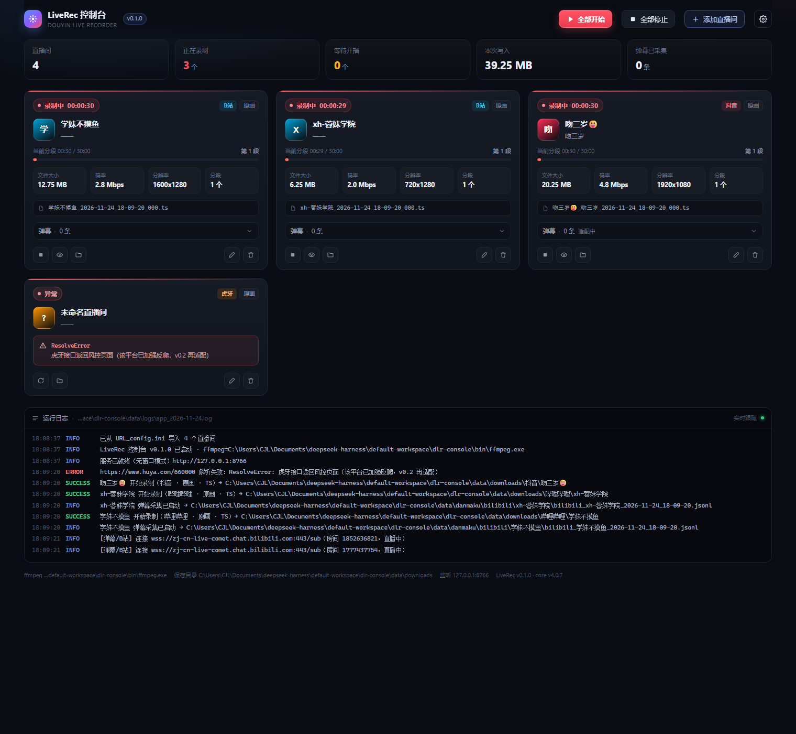
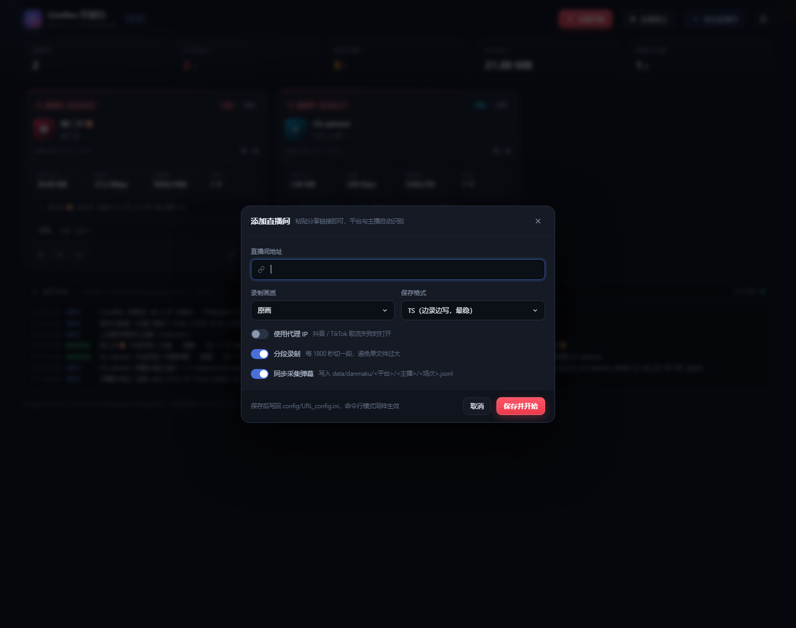
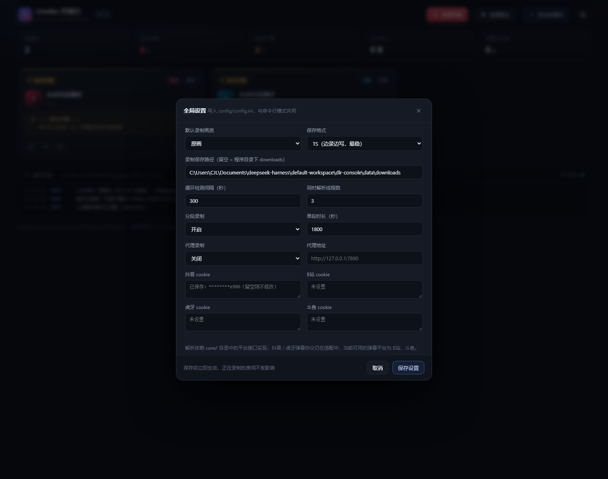

# LiveRec 控制台

一个给直播间录像用的 Windows 小工具：把抖音 / B站 / 虎牙 / 斗鱼的直播间链接粘进来，它就会一直帮你盯着，
开播就自动开录、下播就回到等待，多开几个房间也没问题。录像、弹幕都落在你自己的目录里，程序本体不联网上报任何东西。



## 功能

**录制**

- 多直播间同时录制，一个房间一张卡片，卡片上能看到状态、录制时长、分段进度、文件大小（这一场累计）、码率、分辨率、当前文件名
- 开播自动录，下播/断流自动回到等待开播，按「开播检测间隔」反复回查
- 分段录制：按「单段时长」把一场直播切成多个成品文件（每张卡片还能单独选「不分段 / 自定义时长」）
- 停止录制的秒回：点了停止立刻响应，分片在后台合并完再落盘，卡片不会卡住
- 保存格式可选 `flv / ts / mkv / mp4 / mp3 / m4a`，保存目录可以按主播名分文件夹

**弹幕**

- 四个平台都能收弹幕，卡片里点「弹幕」行就能展开看实时弹幕
- 弹幕按场次写成 `jsonl`（带相对录制起点的毫秒偏移），方便事后对齐回放
- 每张卡片可以单独开关弹幕；弹幕关掉后卡片上不会显示多余的一行

**体验**

- 整页固定一屏：卡片区占中间，超过两行就在卡片区内部滚动，页面右侧不会出现滚动条
- 运行日志区支持按等级筛选（全部 / INFO / 成功 / 警告 / 错误），只在你看最底部时才自动滚到底
- 系统托盘常驻：关掉窗口录制继续，托盘里能唤回控制台、全部开始、全部停止、打开录制目录
- 启动约 1.5 秒（服务先起、窗口并行加载）

**数据**

- 配置文件会自己收敛：只保留程序真正用到的键，上游遗留的推送/账号/几十个平台 cookie 会被清掉
- 设置里的路径按「相对程序目录」保存，整个 `LiveRec` 文件夹搬到别的盘也不会失效
- 同一个程序目录只会有一个实例（重复双击是把窗口唤回来）；**复制到另一个目录就是另一份程序**，两份可以同时跑、各自有自己的 `data\`

## 平台支持

| 平台  | 录制  | 弹幕  | 备注                                               |
| --- | --- | --- | ------------------------------------------------ |
| 抖音  | ✅   | ✅   | 原画需要登录 Cookie；弹幕走 webcast WebSocket（需要 ttwid）    |
| B站  | ✅   | ✅   | 未登录最高「超清」，填了 Cookie 才有「原画」；弹幕走 danmaku WebSocket |
| 斗鱼  | ✅   | ✅   | 取最高码率线路；弹幕走裸 TCP（独立心跳，不会两分钟一断）                   |
| 虎牙  | ✅   | ✅   | 走 HLS（几秒一片），分片先落临时目录、攒够时长再合并                     |

支持的链接形态：`live.douyin.com/<rid>`、`v.douyin.com` 短链、`www.douyin.com/follow/live/<rid>`、
`live.bilibili.com/<rid>`、`www.huya.com/<rid>`、`www.douyu.com/<rid>`。

## 快速开始

1. 下载/解压后直接双击 `LiveRec.exe`。
2. 点右上角「添加直播间」，粘贴直播间链接，程序会自动识别平台、主播和是否在播。
3. 需要登录画质（比如抖音原画、B站原画）就到「设置」里把对应平台的 Cookie 填进去，点「检测」确认有效。
4. 点「保存并开始」即刻开录；也可以之后在卡片上单独点开始。



## 目录结构

```
LiveRec\
├─ LiveRec.exe          主程序
├─ _internal\           运行时与资源（ffmpeg 在这里面，别删）
└─ data\
   ├─ config\           config.ini（全局设置）、URL_config.ini（房间清单）
   ├─ downloads\         默认保存目录（可在设置里改到别的盘）
   ├─ manifests\         虎牙分片清单（每批一份 txt）
   ├─ danmaku\           danmaku.db（弹幕索引）
   ├─ logs\              app-YYYY-MM-DD.log、crash.log
   └─ webview\           Edge 窗口的缓存（可以随时删）
```

## 录制是怎么切文件、怎么合并的

**普通平台（抖音 / B站 / 斗鱼）**：一条线路一个 ffmpeg 进程，按「单段时长」直接切成品文件，
文件名形如 `主播_标题_2026-11-27_10-05-12_000.flv`，不产生任何清单文件。

**虎牙**：走 HLS，上游是 2–4 秒一片的传输分片，所以：

1. 分片先落到 `<保存路径>\merge-tmp\<场次名>\`，**录制中不合并**（合并会把正在被引用的分片搬走，导致续录失败）
2. 累计时长够一段（默认 1800 秒，也就是卡片上「单段时长」）就合并成一个成品 `<场次名>_part000.flv`，放进保存目录
3. 每批分片都会在 `data\manifests\` 留一份清单 `<场次名>_part000.shards.txt`：每个分片的文件名 / 大小 / 时长，末尾一行是合计
4. 停止或下播时把剩下的分片合并收尾、清理临时目录



## 断流与等待开播

- 虎牙：连续 8 秒没有写入就丢掉当前地址、重新解析新地址接着录（不重签旧地址）；连续两次没数据才回到等待开播并停掉弹幕
- 抖音弹幕：25 秒收不到推流帧就主动重连，重连间隔压到 0.8 秒起步，不会一断就是二十几秒的空档
- 斗鱼弹幕：独立心跳线程，服务端不会因为「只读不写」把连接掐掉
- 其它平台：一段里连续两次零字节才回到等待开播（每次给 20 秒宽限）

## 设置项

| 设置          | 说明                                            |
| ----------- | --------------------------------------------- |
| 默认录制画质      | 原画 / 超清 / 高清 / 标清 / 流畅，实际能拿到哪一档由平台决定（卡片上会标出来） |
| 保存格式        | 成品文件的封装格式（不代表录制时的原始格式，虎牙原始是 FLV/TS 流）         |
| 录制保存路径      | 留空 = 程序目录下 `data\downloads`                   |
| 弹幕保存路径      | 留空 = 跟着每场录像目录走（`<录像目录>\danmaku\`）             |
| ffmpeg 路径   | 留空 = 用内置的那个（`_internal\bin\ffmpeg.exe`）       |
| 开播检测间隔      | 等待开播时的回查间隔（秒）                                 |
| 同时解析线程数     | 同一时刻允许几个直播间在访问平台接口（不影响同时录制数）                  |
| 分段录制 / 单段时长 | 全局的分段策略，每张卡片可以单独覆盖                            |
| Cookie      | 四个平台各一份，填了就用于高画质和弹幕鉴权                         |

## 配置文件

`data\config\config.ini` 只有这些键（启动时会自动补齐/清理）：

```
[录制设置]
直播保存路径(不填则默认)
保存文件夹是否以作者区分
视频保存格式ts|mkv|flv|mp4|mp3音频|m4a音频
原画|超清|高清|标清|流畅
同一时间访问网络的线程数
分段录制是否开启
视频分段时间(秒)
开播检测间隔(秒)
ffmpeg路径(不填则用内置)
弹幕保存路径(不填则跟随视频目录)

[Cookie]
抖音cookie
b站cookie
虎牙cookie
斗鱼cookie
```

`data\config\URL_config.ini` 是房间清单，一行一个：

```
画质,URL,主播: 名字
```

- 画质写的是**实际解析到的档位**（你选原画、平台只给超清，这里就是「超清」）
- 行首加 `#` 表示这个房间停用但仍保留
- 手动改这个文件也能用，启动后会被读进界面

## 命令行

```
LiveRec.exe --help
  --port N         指定监听端口（默认自动挑一个空闲的）
  --no-window      只跑服务，不开窗口
  --no-tray        不启用托盘（关窗就退出）
  --tray-only      只驻留托盘，不自动开窗
```

## 开发与打包

```bash
pip install -r requirements.txt
python run.py                 # 开发态启动（默认 http://127.0.0.1:8765）
python -m PyInstaller LiveRec.spec --noconfirm --clean --distpath build\out --workpath build\work
```

打包产物是**文件夹模式**：`build\out\LiveRec\`（`LiveRec.exe` + `_internal\`）。
把它复制到 `dist\LiveRec\` 时不要覆盖同目录的 `data\`。

## 常见问题

**为什么卡片上有时候显示「超清·降级」？**
平台没给你选的那一档（例如 B站未登录最高只到超清），程序按能拿到的最高档录，并把实际档位标出来。

**为什么虎牙的录像有很多 part 文件？**
虎牙按「单段时长」切段，`part000 / part001 / …` 就是一段一个成品；`data\manifests\` 里有对应的分片清单。

**关掉窗口还在录吗？**
在。关窗只是关界面，托盘图标还在，录制继续；要彻底退出请用托盘菜单的「退出」。

**移植到别的机器 / 别的盘？**
把整个 `LiveRec\` 文件夹拷过去就行，设置里的路径是相对保存的，会自动跟着走。

## 已知限制

- 只支持 Windows（托盘与窗口用的是 Win32 + Edge `--app`）
- 虎牙走 HLS，偶发上游几秒不给新分片时日志会提示一次「8 秒没有再写入数据」，然后换地址续录
- 抖音原画、B站原画需要有效 Cookie；未登录会被平台限到最高「超清」
- 弹幕只保存文本与基础用户信息，不含进场特效、礼物动画等

## 致谢

解析思路参考了 [ihmily/DouyinLiveRecorder](https://github.com/ihmily/DouyinLiveRecorder) 与
[stream-rec](https://github.com/hua0512/stream-rec) 两个开源项目，本项目的实现是重新写的独立版本。

## 许可

本项目的代码按 MIT 协议使用。随发布压缩包分发的第三方组件（FFmpeg、Python 运行时、
PyInstaller bootloader、V8 等）各自的许可，以及参考过的开源实现，全部列在 [NOTICE.md](NOTICE.md) 里。
